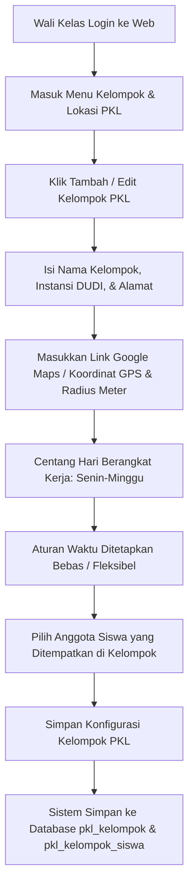
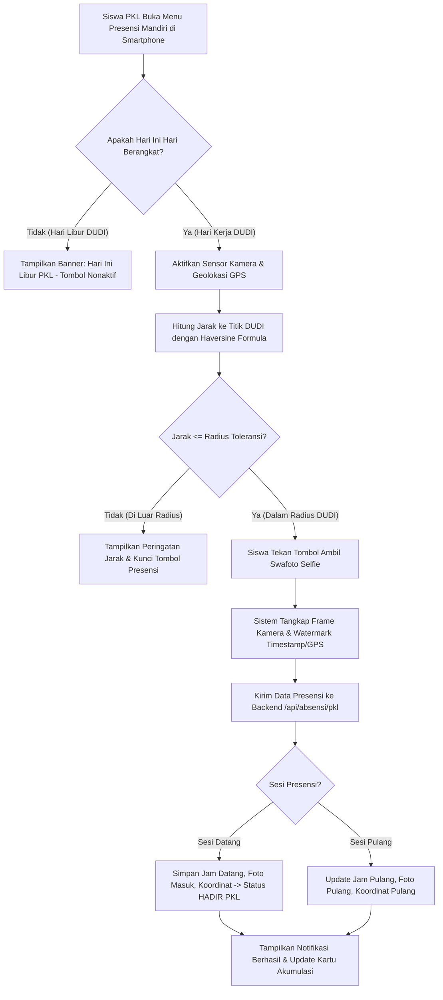
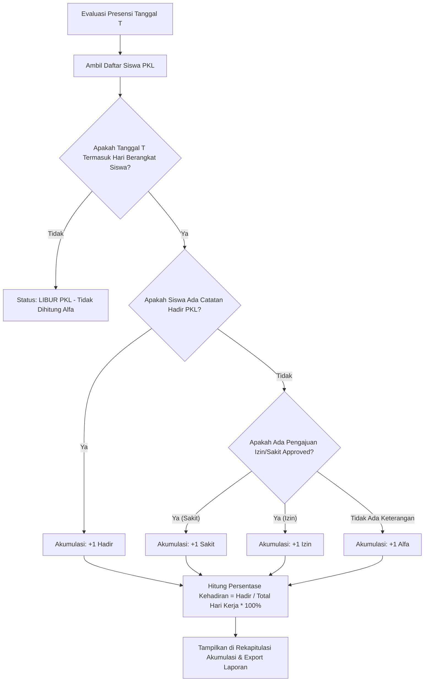

# PRODUCT REQUIREMENTS DOCUMENT (PRD) — VERSI 4.0 (REVISI PKL)
## Sistem Presensi Terpadu IoT RFID & Modul Khusus Presensi Praktik Kerja Lapangan (PKL)
### SMK NU WARGABINANGUN CIREBON

---

| Parameter Dokumen | Informasi Spesifikasi |
| :--- | :--- |
| **Nama Dokumen** | Product Requirements Document (PRD) — Revisi Modul Presensi PKL & Aturan Kehadiran Fleksibel |
| **Versi Dokumen** | **Versi 4.0** *(Revisi Fungsional Pasca Uji Coba: Absensi PKL Mandiri & Rekap Akumulasi)* |
| **Tanggal Efektif** | 29 Oktober 2026 |
| **Institusi** | SMK NU Wargabinangun Cirebon |
| **Target Pengguna** | Wali Kelas PKL, Siswa PKL (DUDI), Guru Pembimbing PKL, Admin Sekolah, & Kepala Sekolah |
| **Status Dokumen** | **Disetujui & Siap Diimplementasikan (Approved for Production Implementation)** |
| **Arsitektur Teknis** | Native PHP 8 MVC, Tailwind CSS, Geolocation API, Camera WebRTC, MySQL Database |

---

## 1. Executive Summary & Latar Belakang Revisi

### 1.1 Latar Belakang
SMK NU Wargabinangun menyelenggarakan program Praktik Kerja Lapangan (PKL) / Magang Industri bagi siswa tingkat menengah kejuruan (Jurusan Teknik Sepeda Motor / TSM, Teknik Kendaraan Ringan / TKR, dan Teknik Komputer & Jaringan / TKJ). Selama masa PKL berlangsung, siswa tidak beraktivitas di lingkungan fisik sekolah, melainkan ditempatkan di berbagai Dunia Usaha dan Dunia Industri (DUDI) mitra dengan lokasi geografis yang tersebar.

Kondisi ini menimbulkan tantangan operasional presensi:
1. **Tidak Dapat Menggunakan Kartu RFID Gerbang:** Siswa PKL tidak dapat melakukan tap fisik kartu RFID di mesin gerbang sekolah setiap pagi.
2. **Karakteristik Jam Kerja DUDI yang Bervariasi (Bebas / Fleksibel):** Masing-masing tempat industri memiliki jam operasional yang berbeda (misalnya: bengkel buka pukul 08:30 WIB, kantor instansi pukul 07:45 WIB, atau sistem shift). Oleh karena itu, batasan jam masuk sekolah konvensional (07:00 - 07:15 WIB) **tidak relevan dan tidak boleh diberlakukan** untuk siswa PKL.
3. **Variasi Jadwal Hari Berangkat/Kerja:** Ada instansi DUDI yang memberlakukan 5 hari kerja (Senin - Jumat), 6 hari kerja (Senin - Sabtu), atau hari-hari tertentu (misal: Senin, Rabu, Jumat). Wali Kelas memerlukan wewenang penuh untuk menetapkan hari-hari apa saja siswa diwajibkan berangkat PKL.
4. **Kebutuhan Data Akumulasi Presensi (H/S/I/A):** Pihak sekolah, wali kelas, guru pembimbing, dan orang tua membutuhkan laporan rekapitulasi akumulasi kehadiran (Hadir, Sakit, Izin, Alfa) yang jelas dan terukur sebagai salah satu komponen nilai kedisiplinan pada lembar sertifikat/sidang PKL.

### 1.2 Ringkasan Solusi pada PRD Versi 4.0
Dokumen PRD Versi 4.0 ini mendefinisikan pembaruan sistem yang berfokus pada:
- **Modul Presensi Khusus PKL:** Presensi mandiri via web browser smartphone menggunakan swafoto kamera (kamera depan realtime) dan validasi geolokasi GPS berbasis titik koordinat DUDI dengan radius toleransi tertentu.
- **Aturan Kehadiran di Wali Kelas (Jadwal Hari Berangkat):** Wali Kelas memiliki menu konfigurasi untuk mencentang hari kerja/berangkat siswa PKL (misal: Senin s/d Jumat atau hari custom).
- **Aturan Waktu Fleksibel (Bebas Tanpa Batas Jam Kaku):** Sistem **tidak mengunci jam masuk dan jam pulang**. Siswa dapat melakukan presensi kapan saja selama hari aktif tersebut sesuai jam kerja instansi DUDI masing-masing tanpa terkena penalti "Terlambat".
- **Akumulasi Data Presensi PKL:** Dashboard dan laporan rekapitulasi yang secara otomatis menghitung akumulasi total Hadir (H), Sakit (S), Izin (I), dan Alfa (A) beserta persentase kehadiran siswa selama periode PKL.

---

## 2. Tujuan & Indikator Keberhasilan (Product Goals & KPIs)

### 2.1 Tujuan Produk
1. Menyediakan sarana presensi mandiri bagi siswa PKL yang valid, bebas kecurangan (*fraud-resistant*), dan mudah diakses melalui ponsel pintar.
2. Memberikan fleksibilitas bagi Wali Kelas dalam mengatur hari kerja masing-masing kelompok siswa PKL sesuai kesepakatan dengan pihak industri.
3. Menghilangkan friksi absensi akibat perbedaan jam operasional industri melalui kebijakan waktu presensi terbuka (*open time window*).
4. Menyediakan kalkulasi akumulasi data kehadiran PKL secara otomatis untuk mempermudah evaluasi akhir masa magang.

### 2.2 Target Keberhasilan & KPI
| Indikator (KPI) | Target | Mekanisme Realisasi Lapangan |
| :--- | :--- | :--- |
| **Validitas Lokasi Presensi** | ≥ 99.5% akurat | Menggunakan perhitungan jarak Haversine formula antara koordinat GPS ponsel dengan koordinat DUDI yang diinput Wali Kelas. |
| **Pencegahan Kecurangan Foto** | 100% live capture | Kamera WebRTC langsung dari sensor peramban (tanpa izin unggah galeri file foto lama). |
| **Fleksibilitas Operasional DUDI** | 100% adaptif | Waktu jam masuk/pulang tidak dipatok jam kaku; presensi valid dicatat sepanjang hari kerja terjadwal. |
| **Efisiensi Rekapitulasi Nilai** | Otomatis (0 menit hitung manual) | Mesin kalkulasi akumulasi langsung menyajikan total Hadir, Izin, Sakit, dan Alfa beserta % kehadiran per siswa. |

---

## 3. Matriks Peran Pengguna (User Persona & RBAC)

| Peran (Role) | Hak Akses & Tanggung Jawab pada Modul PKL |
| :--- | :--- |
| **Wali Kelas** | 1. Mengelola kelompok PKL per kelas binaannya (Nama Kelompok, Instansi DUDI, Alamat, Link Google Maps / Koordinat GPS, Radius Meter).<br>2. **Mengatur aturan hari berangkat PKL** (menentukan hari apa saja siswa wajib berangkat, misal: Senin, Selasa, Rabu, Kamis, Jumat).<br>3. Memasukkan siswa ke dalam kelompok PKL terkait (*Group Assignment*).<br>4. Memantau kehadiran harian siswa PKL (melihat selfie masuk/pulang dan jarak GPS).<br>5. Memvalidasi dan menyetujui/menolak pengajuan surat Izin/Sakit siswa PKL.<br>6. Melihat dan mengekspor rekapitulasi data akumulasi presensi PKL (H/S/I/A) ke Excel (.xlsx). |
| **Siswa PKL** | 1. Melihat informasi kelompok PKL, nama instansi DUDI, titik lokasi, dan jadwal hari berangkat yang telah ditetapkan Wali Kelas.<br>2. Melakukan presensi masuk (Check-in) dan presensi pulang (Check-out) menggunakan kamera swafoto & GPS di lokasi DUDI pada hari aktif kerja.<br>3. Waktu presensi bebas/fleksibel mengikuti jadwal tempat kerja.<br>4. Mengajukan surat izin/sakit disertai bukti foto/dokumen jika berhalangan hadir.<br>5. Melihat ringkasan akumulasi kehadiran pribadi (Total Hadir, Izin, Sakit, Alfa, dan % Kehadiran). |
| **Administrator** | 1. Hak kontrol penuh terhadap seluruh kelas PKL dan master kelompok.<br>2. Menjalankan fungsi pemeliharaan sistem, migrasi basis data, dan sinkronisasi Auto-Alfa PKL.<br>3. Mengunduh laporan rekapitulasi akumulasi global seluruh jurusan. |
| **Kepala Sekolah** | 1. Mengakses dashboard monitoring eksekutif tingkat kehadiran siswa PKL sekolah.<br>2. Meninjau analitik kedisiplinan siswa magang industri sebagai bahan evaluasi kemitraan DUDI sekolah. |

---

## 4. Spesifikasi Kebutuhan Fungsional (Functional Requirements)

### 4.1 Modul Konfigurasi Aturan Kehadiran di Wali Kelas (FR-PKL-01)
Wali Kelas memiliki wewenang penuh untuk mengatur konfigurasi kerja masing-masing kelompok PKL melalui menu **Kelompok & Lokasi PKL**:

1. **Pengaturan Hari Berangkat / Hari Kerja (Active Days Configuration):**
   - Wali Kelas dapat memilih hari-hari apa saja siswa berangkat kerja menggunakan opsi checklist interaktif 7 hari:
     - `[✓] Senin`
     - `[✓] Selasa`
     - `[✓] Rabu`
     - `[✓] Kamis`
     - `[✓] Jumat`
     - `[ ] Sabtu`
     - `[ ] Minggu`
   - Opsi default adalah 5 hari kerja (Senin s/d Jumat), namun dapat disesuaikan per kelompok (misal: bengkel yang buka Senin s/d Sabtu).
   - Hari yang **tidak dicentang** secara otomatis dikategorikan sebagai **Hari Libur PKL** dan tidak akan pernah dihitung sebagai Alfa bagi siswa.

2. **Kebijakan Waktu Bebas / Fleksibel (No Fixed Schedule):**
   - **Waktu presensi tidak dibatasi secara kaku:** Tidak ada input jam masuk, jam pulang, toleransi menit, atau jam cutoff keterlambatan.
   - Presensi kedatangan siswa di hari kerja yang telah dijadwalkan langsung diakui sebagai status **HADIR (PKL)** berapapun jam kedatangannya, tanpa status "Terlambat".
   - Siswa dapat melakukan presensi pulang setelah menyelesaikan tugas magangnya di hari yang sama.

3. **Pengaturan Titik Lokasi DUDI & Geofencing:**
   - Input nama instansi DUDI dan alamat lengkap.
   - Penguraian otomatis koordinat Latitude & Longitude dari tautan Google Maps (`https://maps.app.goo.gl/...` atau URL koordinat).
   - Penentuan radius toleransi presensi dalam satuan meter (default: 50 meter; dapat disesuaikan antara 20 - 200 meter sesuai luas area instansi).
   - Data kontak pembimbing lapang industri (nama & no. WhatsApp) untuk keperluan koordinasi darurat.

---

### 4.2 Modul Presensi Mandiri Siswa PKL (FR-PKL-02)
Siswa dengan status kelas PKL mengakses menu **Presensi Mandiri PKL** (`/absensi/pkl`) melalui smartphone dengan alur operasional:

1. **Pemeriksaan Jadwal Hari Kerja:**
   - Sistem mendeteksi hari saat ini (Current Day).
   - Jika hari ini **bukan** merupakan hari berangkat yang diatur Wali Kelas, antarmuka menampilkan pesan informatif: *"Hari ini adalah jadwal libur PKL untuk kelompok Anda. Anda tidak perlu melakukan presensi."* (Tombol presensi dinonaktifkan).
   - Jika hari ini merupakan hari berangkat kerja, sistem mengaktifkan modul kamera dan GPS.

2. **Validasi Geofence & Jarak GPS:**
   - Mengambil koordinat GPS presisi tinggi (`navigator.geolocation.getCurrentPosition`) dengan opsi `enableHighAccuracy: true`.
   - Menghitung jarak lurus ke titik DUDI menggunakan rumus Haversine.
   - Status indikator jarak:
     - **Hijau (Dalam Radius):** Jarak siswa ≤ radius meter tempat PKL (misal: 18.5 meter ≤ 50 meter). Tombol Ambil Foto & Presensi aktif.
     - **Merah (Di Luar Radius):** Jarak siswa > radius meter (misal: 250 meter > 50 meter). Sistem menampilkan peringatan jarak dan menonaktifkan pengiriman presensi.

3. **Verifikasi Swafoto (Live Camera Streaming):**
   - Menghubungkan kamera depan perangkat secara langsung via WebRTC Stream.
   - Pencegahan kecurangan: Sistem tidak menyediakan tombol "Pilih Berkas / Upload Galeri". Foto harus diambil langsung dari umpan video kamera saat itu juga.
   - Kompresi gambar client-side (maksimal 800x600 px format JPEG) untuk menghemat kuota internet siswa dan bandwidth server.

4. **Sesi Presensi Masuk & Pulang:**
   - **Presensi Masuk:** Dilakukan pertama kali di hari kerja. Mencatat `jam_datang`, `foto_masuk`, `latitude_masuk`, `longitude_masuk`, `jarak_meter`, dan status `'pkl'`.
   - **Presensi Pulang:** Dilakukan sebelum meninggalkan lokasi DUDI di hari yang sama. Mencatat `jam_pulang`, `foto_pulang`, `latitude_pulang`, `longitude_pulang`.

---

### 4.3 Modul Akumulasi Data Kehadiran PKL (FR-PKL-03)
Sistem memiliki mesin rekapitulasi akumulatif yang menghitung seluruh riwayat kehadiran siswa selama masa PKL:

#### A. Definisi Status Kehadiran PKL
1. **Hadir (H):** Siswa melakukan presensi masuk mandiri di lokasi DUDI pada hari kerja terjadwal.
2. **Sakit (S):** Siswa mengajukan surat izin sakit berlampir surat dokter/keterangan medis yang telah disetujui (Approved) oleh Wali Kelas.
3. **Izin (I):** Siswa mengajukan izin keperluan keluarga/dinas industri yang telah disetujui (Approved) oleh Wali Kelas.
4. **Alfa (A):** Siswa **tidak hadir** dan tidak melakukan presensi pada hari kerja yang telah dijadwalkan oleh Wali Kelas, serta tidak memiliki pengajuan izin/sakit yang sah.
5. **Libur PKL (L):** Hari di luar jadwal hari berangkat yang telah ditentukan Wali Kelas (tidak dihitung dalam akumulasi penalti Alfa).

#### B. Rumus Kalkulasi Akumulasi & Persentase Kehadiran
$$\text{Total Hari Efektif Terjadwal} = \sum (\text{Hari Kerja Aktif yang Telah Berjalan})$$

$$\text{Total Hari Terhitung} = \text{Hadir} + \text{Sakit} + \text{Izin} + \text{Alfa}$$

$$\text{Persentase Kehadiran (\%)} = \left( \frac{\text{Hadir}}{\text{Total Hari Efektif Terjadwal}} \right) \times 100\%$$

*Catatan Akademik:* Untuk kriteria kelulusan PKL, nilai kedisiplinan presensi mensyaratkan persentase kehadiran minimal **85%** dari total hari efektif yang dijadwalkan.

#### C. Logika Auto-Alfa PKL
- Sistem melakukan sinkronisasi otomatis harian (atau pada saat rekap dibuka):
- Untuk setiap siswa di kelas PKL:
  1. Periksa apakah tanggal tertentu merupakan hari berangkat aktif kelompok siswa tersebut.
  2. Jika YA (hari aktif), periksa apakah ada catatan kehadiran di tabel `absensi_siswa` atau ada izin/sakit di tabel `izin`.
  3. Jika tidak ada catatan hingga pergantian hari (pukul 23:59 WIB), sistem secara otomatis mencatatkan status sebagai **Alfa (A)** untuk tanggal tersebut.

---

### 4.4 Modul Laporan & Dashboard Akumulasi (FR-PKL-04)

1. **Dashboard Wali Kelas — Tab Khusus PKL:**
   - **Kartu Ringkasan Kelas:**
     - Total Siswa PKL
     - Jumlah Kelompok / Tempat DUDI
     - Kehadiran Hari Ini (Masuk, Pulang, Belum Hadir)
     - Rata-rata Persentase Kehadiran Kelas
   - **Tabel Monitoring Harian:** Menampilkan daftar siswa, nama DUDI, jam datang, jam pulang, jarak GPS, dan thumbnail selfie.

2. **Halaman Rekapitulasi & Akumulasi PKL:**
   - **Filter Fleksibel:**
     - Rentang Tanggal (Dari Tanggal — Sampai Tanggal)
     - Filter Berdasarkan Kelompok / Tempat DUDI
     - Pencarian Siswa (Nama / NIS)
   - **Tabel Matriks Akumulasi:**
     - No, NIS, Nama Siswa, Kelompok / Instansi DUDI, Hari Kerja Terjadwal, **Total Hadir (H)**, **Total Sakit (S)**, **Total Izin (I)**, **Total Alfa (A)**, **Total Hari Efektif**, dan **Persentase Kehadiran (%)**.
   - **Badge Indikator Kedisiplinan:**
     - `≥ 90%` : Badge Hijau (*Sangat Disiplin*)
     - `75% - 89%` : Badge Kuning (*Cukup / Perhatian*)
     - `< 75%` : Badge Merah (*Kurang / Peringatan Disiplin*)
   - **Ekspor Data:**
     - Tombol *Export Excel (.xlsx)* yang menghasilkan berkas rekap formal lengkap dengan kop sekolah SMK NU Wargabinangun, tanda tangan Wali Kelas, dan Kepala Sekolah.

3. **Dashboard Siswa PKL — Kartu Akumulasi Pribadi:**
   - Siswa dapat melihat progres kehadiran pribadinya secara realtime:
     - Card Hadir: `XX Hari`
     - Card Sakit: `XX Hari`
     - Card Izin: `XX Hari`
     - Card Alfa: `XX Hari`
     - Progress Bar Persentase Kehadiran: `XX%`

---

## 5. Diagram Alur Kerja Sistem (System Workflows)

### 5.1 Alur Konfigurasi Aturan Hari Berangkat oleh Wali Kelas


### 5.2 Alur Presensi Mandiri Siswa PKL (Waktu Bebas & Validasi GPS)


### 5.3 Alur Evaluasi Akumulasi & Penentuan Status Alfa PKL


---

## 6. Spesifikasi Skema Basis Data (Database Schema)

Untuk mendukung aturan kehadiran hari berangkat bebas waktu dan akumulasi data, dilakukan penyesuaian skema database relasional:

### 6.1 Pembaruan Tabel `pkl_kelompok`
Menyimpan konfigurasi kelompok PKL, lokasi GPS, dan hari aktif kerja:

```sql
CREATE TABLE IF NOT EXISTS pkl_kelompok (
    id INT AUTO_INCREMENT PRIMARY KEY,
    kelas_id INT NOT NULL,
    nama_kelompok VARCHAR(100) NOT NULL,
    nama_tempat VARCHAR(150) NOT NULL,
    alamat TEXT NULL,
    link_lokasi TEXT NULL,
    latitude DECIMAL(11, 8) NOT NULL,
    longitude DECIMAL(11, 8) NOT NULL,
    radius_meter INT DEFAULT 50,
    pembimbing_nama VARCHAR(100) NULL,
    pembimbing_kontak VARCHAR(50) NULL,
    
    -- KOLOM ATURAN KEHADIRAN BARU --
    hari_kerja VARCHAR(100) NOT NULL DEFAULT '["Senin","Selasa","Rabu","Kamis","Jumat"]',
    is_jam_bebas TINYINT(1) NOT NULL DEFAULT 1,
    
    created_by INT NULL,
    created_at TIMESTAMP DEFAULT CURRENT_TIMESTAMP,
    updated_at TIMESTAMP DEFAULT CURRENT_TIMESTAMP ON UPDATE CURRENT_TIMESTAMP,
    FOREIGN KEY (kelas_id) REFERENCES kelas(id) ON DELETE CASCADE,
    FOREIGN KEY (created_by) REFERENCES users(id) ON DELETE SET NULL
) ENGINE=InnoDB DEFAULT CHARSET=utf8mb4;
```

### 6.2 Tabel Penugasan Anggota `pkl_kelompok_siswa`
```sql
CREATE TABLE IF NOT EXISTS pkl_kelompok_siswa (
    id INT AUTO_INCREMENT PRIMARY KEY,
    kelompok_id INT NOT NULL,
    siswa_id INT NOT NULL UNIQUE,
    created_at TIMESTAMP DEFAULT CURRENT_TIMESTAMP,
    FOREIGN KEY (kelompok_id) REFERENCES pkl_kelompok(id) ON DELETE CASCADE,
    FOREIGN KEY (siswa_id) REFERENCES siswa(id) ON DELETE CASCADE
) ENGINE=InnoDB DEFAULT CHARSET=utf8mb4;
```

### 6.3 Pembaruan Transaksi `absensi_siswa` (Tercatat Riwayat PKL)
```sql
-- Memastikan ENUM status memuat 'pkl'
ALTER TABLE absensi_siswa MODIFY COLUMN status 
    ENUM('hadir','terlambat','izin','sakit','alfa','pulang_cepat','pkl') DEFAULT 'alfa';

-- Kolom audit jejak geolokasi dan swafoto
-- foto_masuk VARCHAR(255) NULL
-- foto_pulang VARCHAR(255) NULL
-- latitude_masuk DECIMAL(11, 8) NULL
-- longitude_masuk DECIMAL(11, 8) NULL
-- latitude_pulang DECIMAL(11, 8) NULL
-- longitude_pulang DECIMAL(11, 8) NULL
-- jarak_meter INT NULL
```

### 6.4 Struktur Query Akumulasi Presensi PKL
Query agregasi untuk menyusun tabel akumulasi per siswa dalam periode tertentu:
```sql
SELECT 
    s.id AS siswa_id,
    s.nis,
    u.name AS nama_siswa,
    pk.nama_kelompok,
    pk.nama_tempat,
    pk.hari_kerja,
    COUNT(CASE WHEN a.status = 'pkl' OR a.status = 'hadir' THEN 1 END) AS total_hadir,
    COUNT(CASE WHEN a.status = 'sakit' THEN 1 END) AS total_sakit,
    COUNT(CASE WHEN a.status = 'izin' THEN 1 END) AS total_izin,
    COUNT(CASE WHEN a.status = 'alfa' THEN 1 END) AS total_alfa
FROM siswa s
JOIN users u ON s.user_id = u.id
JOIN pkl_kelompok_siswa pks ON s.id = pks.siswa_id
JOIN pkl_kelompok pk ON pks.kelompok_id = pk.id
LEFT JOIN absensi_siswa a ON s.id = a.siswa_id 
    AND a.tanggal BETWEEN :tgl_mulai AND :tgl_selesai
WHERE s.kelas_id = :kelas_id
GROUP BY s.id
ORDER BY pk.nama_kelompok ASC, u.name ASC;
```

---

## 7. Desain Antarmuka Pengguna (UI/UX Guidelines)

Sesuai dengan standar desain sistem modern SMK NU Wargabinangun (Clean Modern Slate & Deep Navy Dark Mode, Tailwind CSS, Font Inter & JetBrains Mono):

### 7.1 Form Modal Pengaturan Kelompok PKL (Wali Kelas)
- **Komponen Checklist Hari Berangkat:**
  - Ditampilkan dalam bentuk kotak pill/toggle tombol yang menarik:
  - Setiap hari (Senin, Selasa, Rabu, Kamis, Jumat, Sabtu, Minggu) memiliki checkbox dengan status aktif berwarna hijau emerald saat dicentang.
- **Informasi Kebijakan Waktu Bebas:**
  - Menampilkan banner edukatif berwarna biru muda/indigo:
    > 💡 **Kebijakan Waktu Terbuka (Fleksibel):**
    > Sistem tidak membatasi jam masuk dan jam pulang. Siswa dapat melakukan presensi kapan saja pada hari yang dicentang sesuai jadwal operasional DUDI masing-masing.

### 7.2 Halaman Rekapitulasi & Akumulasi PKL (Wali Kelas & Admin)
- **Tabel Rekap Berwarna:**
  - Kolom **Hadir** diwarnai hijau (Emerald `text-emerald-600 bg-emerald-50 dark:bg-emerald-950/40`).
  - Kolom **Sakit** diwarnai biru (Sky/Blue `text-blue-600 bg-blue-50 dark:bg-blue-950/40`).
  - Kolom **Izin** diwarnai kuning/amber (Amber `text-amber-600 bg-amber-50 dark:bg-amber-950/40`).
  - Kolom **Alfa** diwarnai merah (Rose/Red `text-rose-600 bg-rose-50 dark:bg-rose-950/40`).
  - Kolom **Persentase (%)** dilengkapi progress bar mini dengan angka presisi satu desimal (misal: `94.2%`).

### 7.3 Halaman Presensi Siswa PKL (Mobile Smartphone)
- Kartu status ringkas di bagian atas menampilkan:
  - Tempat DUDI & Nama Kelompok.
  - Hari Kerja Terjadwal (misal: `Senin - Jumat`).
  - Status Jam Hari Ini: `Fleksibel / Sesuai Jam Kerja Instansi`.
  - Jarak GPS realtime ke instansi DUDI.
- Tombol presensi yang besar dan ramah sentuhan jempol (*thumb-friendly button*):
  - Tombol **"Ambil Foto & Presensi Masuk"** (Warna Hijau Emerald).
  - Tombol **"Ambil Foto & Presensi Pulang"** (Warna Biru Indigo).

---

## 8. Rencana Implementasi & Roadmap Pengembangan

| Tahap | Fokus Pekerjaan | Deliverable |
| :--- | :--- | :--- |
| **Tahap 1: Basis Data & Model** | Menambahkan kolom `hari_kerja` dan `is_jam_bebas` pada tabel `pkl_kelompok`. Memperbarui fungsi model `Pkl.php` untuk menyimpan konfigurasi hari kerja. | File migrasi database SQL & Model `Pkl.php` updated. |
| **Tahap 2: Antarmuka Wali Kelas** | Menambahkan elemen checklist hari berangkat pada modal tambah/edit kelompok di `pkl/kelompok.php`. Memperbarui controller `PklController::save_kelompok`. | UI Checklist Hari Berangkat berfungsi penuh. |
| **Tahap 3: Mesin Akumulasi Presensi** | Mengembangkan fungsi kalkulasi agregasi akumulasi (Hadir, Sakit, Izin, Alfa, % Kehadiran) di model `Pkl.php` / `Laporan.php`. | Method `getAkumulasiPresensiPkl()` siap pakai. |
| **Tahap 4: Halaman Rekapitulasi Akumulasi** | Menambahkan sub-menu / tab Akumulasi PKL di `pkl/monitoring.php` atau `rekap_absensi/index.php` lengkap dengan filter dan tombol export Excel. | UI Tabel Akumulasi & Fitur Ekspor Excel. |
| **Tahap 5: Dashboard Siswa & Validasi Hari** | Memperbarui halaman `absensi/pkl.php` untuk memvalidasi apakah hari ini termasuk hari aktif kerja siswa, serta menambahkan widget akumulasi kehadiran pribadi. | Siswa dapat melihat kartu akumulasi & proteksi hari libur. |
| **Tahap 6: Uji Coba & Deployment** | Pengujian fungsional lintas skenario (hari aktif, hari libur, dalam radius, luar radius, akumulasi alfa). | Rollout ke server production SMK NU Wargabinangun. |

---

## 9. Skenario Pengujian (Test Cases)

| ID Uji | Deskripsi Skenario Uji | Hasil yang Diharapkan (Expected Result) | Status |
| :--- | :--- | :--- | :--- |
| **TC-PKL-01** | Wali Kelas mengatur kelompok PKL berangkat hari Senin-Jumat, lalu menyimpan data. | Konfigurasi tersimpan di database dengan format JSON `["Senin","Selasa","Rabu","Kamis","Jumat"]`. | PASS |
| **TC-PKL-02** | Siswa membuka halaman presensi di hari Sabtu (hari tidak dijadwalkan). | Sistem menampilkan informasi bahwa hari Sabtu adalah hari libur PKL, tombol selfie dinonaktifkan. | PASS |
| **TC-PKL-03** | Siswa melakukan presensi masuk di hari Senin pukul 09:15 WIB di dalam radius 30 meter. | Presensi berhasil tersimpan dengan status `'pkl'` (HADIR) tanpa ditandai terlambat. | PASS |
| **TC-PKL-04** | Siswa melakukan presensi di luar radius lokasi DUDI (jarak 200m > radius 50m). | Sistem menolak pengiriman presensi dan menampilkan peringatan jarak GPS. | PASS |
| **TC-PKL-05** | Siswa tidak hadir pada hari Rabu (hari kerja) dan tidak ada surat izin. | Mesin akumulasi otomatis menghitung 1 Alfa untuk tanggal tersebut. | PASS |
| **TC-PKL-06** | Wali Kelas membuka rekap akumulasi kelas PKL selama periode 1 bulan. | Menampilkan tabel total Hadir, Sakit, Izin, Alfa, dan % kehadiran yang sesuai dengan data riil. | PASS |

---

## 10. Pengesahan Dokumen

Dokumen Product Requirements Document (PRD) Versi 4.0 ini dinyatakan sah sebagai acuan pengembangan dan penyempurnaan sistem absensi di SMK NU Wargabinangun Cirebon.

<br>

| Disusun & Direvisi Oleh: | Disetujui & Divalidasi Oleh: |
| :---: | :---: |
| <br><br>____________________________________<br>**Tim Pengembang Sistem & IoT** | <br><br>____________________________________<br>**Kepala Sekolah SMK NU Wargabinangun** |
| Tanggal: 29 Oktober 2026 | Tanggal: 29 Oktober 2026 |
