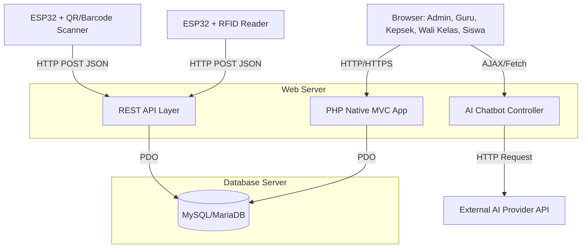
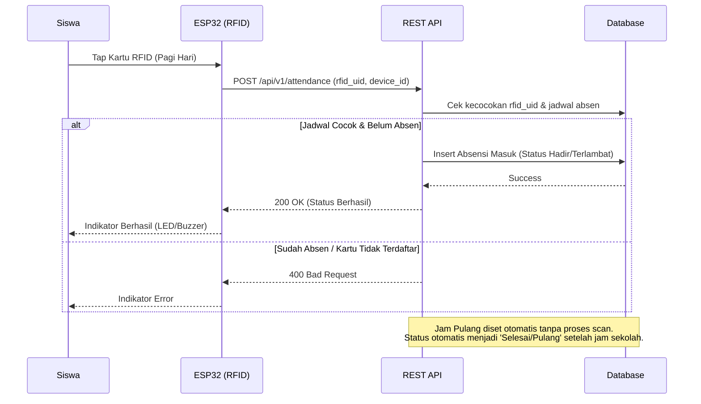
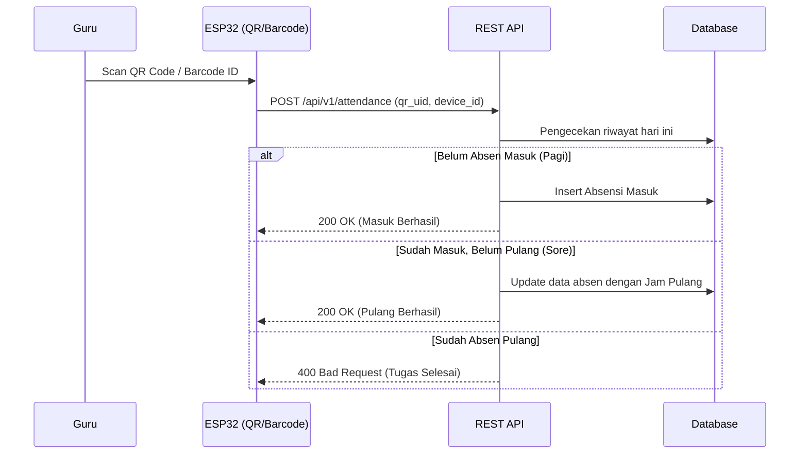
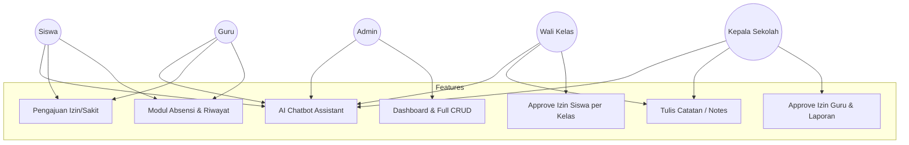

# Arsitektur & Analisis Sistem Absensi SMK

## 1. Analisis Kebutuhan
Sistem Absensi ini ditujukan untuk mengakomodasi dua metode absensi yang berbeda (Siswa dengan RFID satu arah, Guru dengan Barcode/QR dua arah) yang terintegrasi dengan perangkat IoT (ESP32) dan memiliki sistem chatbot AI untuk bantuan penggunaan. Sistem ini dibangun tanpa framework backend (PHP Native + MVC) untuk kesederhanaan dan performa, serta memisahkan akses pengguna menjadi 5 level role.

**Kendala & Solusi Desain:**
- **Siswa tidak scan pulang:** Sistem akan menggunakan rutinitas pengecekan (_trigger_ saat load laporan atau _Cron Job_) untuk menandai kepulangan siswa secara otomatis berdasarkan jadwal kelas dan hari.
- **PHP Native MVC:** Akan dibangun arsitektur *routing* sederhana yang memisahkan Model (PDO), View (HTML/Bootstrap), dan Controller (Logic) untuk kemudahan *maintenance*.
- **ESP32 & REST API:** Dibutuhkan _layer_ API (contoh: `/api/v1/attendance.php`) dengan otentikasi sederhana untuk menerima data dari ESP32 (POST JSON) dengan aman.
- **AI Chatbot:** Akan dibangun endpoint internal yang menjembatani frontend (via AJAX) ke layanan AI eksternal (contoh: OpenAI/Gemini), dilengkapi dengan _System Prompt_ spesifik agar Chatbot memahami konteks website dan pemecahan masalah IoT.

---

## 2. Arsitektur Sistem

Berikut adalah rancangan *High-Level Architecture* sistem secara keseluruhan:



---

## 3. Struktur Folder

Sistem akan dipisahkan menjadi 4 domain utama: `/web`, `/iot`, `/database`, dan `/docs`.

```text
/
├── web/                    # Root folder aplikasi web (PHP MVC)
│   ├── app/                # Core aplikasi
│   │   ├── controllers/    # Controller untuk logic modul
│   │   ├── models/         # Interaksi Database (PDO)
│   │   ├── views/          # Tampilan antarmuka HTML & Bootstrap
│   │   └── core/           # Router, DB Wrapper, Base Class
│   ├── public/             # Folder yang diekspos ke publik (Document Root)
│   │   ├── index.php       # Entry point / Front Controller Frontend
│   │   ├── assets/         # CSS, JS, Image, Icon
│   ├── api/                # Folder khusus endpoint REST API
│   │   └── v1/
│   │       ├── attendance.php
│   │       └── device.php
│   └── config/             # Config koneksi DB, Routing, dan API Keys
├── iot/                    # Source code perangkat keras mikrokontroler
│   ├── esp32_rfid/         # Sketsa Arduino untuk RFID Reader (Siswa)
│   └── esp32_qr/           # Sketsa Arduino untuk QR/Barcode (Guru)
├── database/               # Struktur dan skema relasi
│   ├── schema.sql          # DDL (Definisi Tabel dan Relasi)
│   └── seed.sql            # Dummy data (Admin default, dll)
└── docs/                   # Dokumentasi teknis
    ├── architecture.md
    └── api_reference.md
```

---

## 4. Alur Sistem (Flowcharts)

### A. Alur Absensi Siswa (1 Arah)



### B. Alur Absensi Guru (2 Arah)



### C. Komunikasi ESP32 -> REST API

```mermaid
graph LR
    A[ESP32 Device] -->|HTTP POST Payload| B(REST API URL)
    
    subgraph Payload JSON Example
        C[{"device_id": "ESP_RFID_01", "uid": "A1B2C3D4", "type": "rfid"}]
    end
    
    A -.-> C
    
    B -->|Response JSON Example| D[{"status": "success", "message": "Hadir: Budi", "code": 200}]
```

### D. Role Access Diagram



---

## 5. Daftar Modul

1. **Modul Autentikasi**:
   - Login, Session Management, dan Role-based Access Control (RBAC).
2. **Modul Master Data (Admin)**:
   - Manajemen User (Siswa, Guru, Kepsek, Wali Kelas).
   - Manajemen Akademik (Kelas, Jadwal).
   - Manajemen IoT (Registrasi alat ESP32, assign RFID ke Siswa, assign QR ke Guru).
3. **Modul Absensi & API**:
   - REST API handler.
   - Algoritma penentuan status (Hadir/Terlambat).
   - Sistem auto-pulang untuk siswa.
4. **Modul Izin & Catatan**:
   - Pengajuan dokumen Izin/Sakit.
   - Hierarki *Approval* (Kepsek -> Guru; Wali Kelas -> Siswa).
   - Penulisan instruksi/catatan (*Notes*).
5. **Modul AI Chatbot**:
   - *Widget overlay* di setiap halaman dashboard user.
   - Panggilan backend ke API AI untuk panduan *troubleshooting* (misal: "RFID tidak terbaca") dan navigasi UI.

---

## 6. Daftar Dependency

Sesuai permintaan untuk membuat struktur sederhana tanpa framework kompleks:

**Backend (Web & API):**
* PHP 8.x (Native dengan PDO & cURL extension)
* MySQL 5.7+ / MariaDB 10.x

**Frontend:**
* HTML5, CSS3, ES6 JavaScript
* Bootstrap 5 (CSS Framework via CDN atau lokal untuk UI cepat dan responsif)
* FontAwesome (untuk icon, opsional)

**IoT (Perangkat Keras):**
* Mikrokontroler: ESP32 (Modul WiFi terintegrasi)
* Modul RFID: MFRC522 (untuk Siswa)
* Modul Barcode/QR Scanner: Modul TTL/UART Scanner (untuk Guru)
* Library Arduino: `WiFi.h`, `HTTPClient.h`, `ArduinoJson.h` (wajib untuk komunikasi API), dan `MFRC522.h`.

**Eksternal:**
* AI Provider API (contoh: Google Gemini API / OpenAI API).

## User Review Required
Silakan tinjau struktur arsitektur, _flowchart_ logika, dan modul yang diajukan di atas. Berikan arahan apakah _blueprint_ ini sudah sesuai dengan visi PRD (Product Requirements Document) Anda sebelum kita melanjutkan implementasi lebih dalam.
