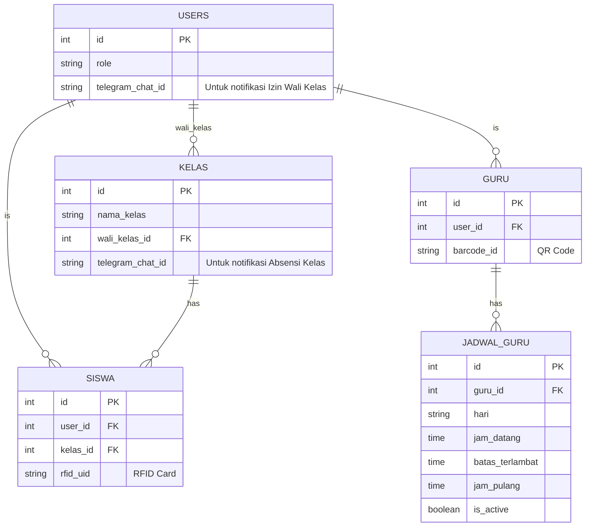
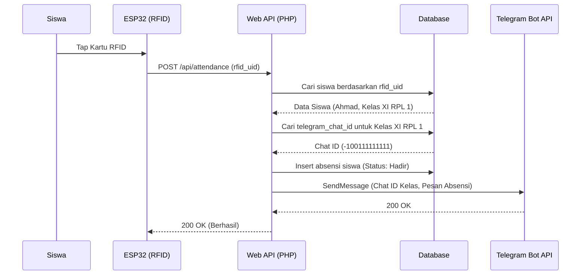
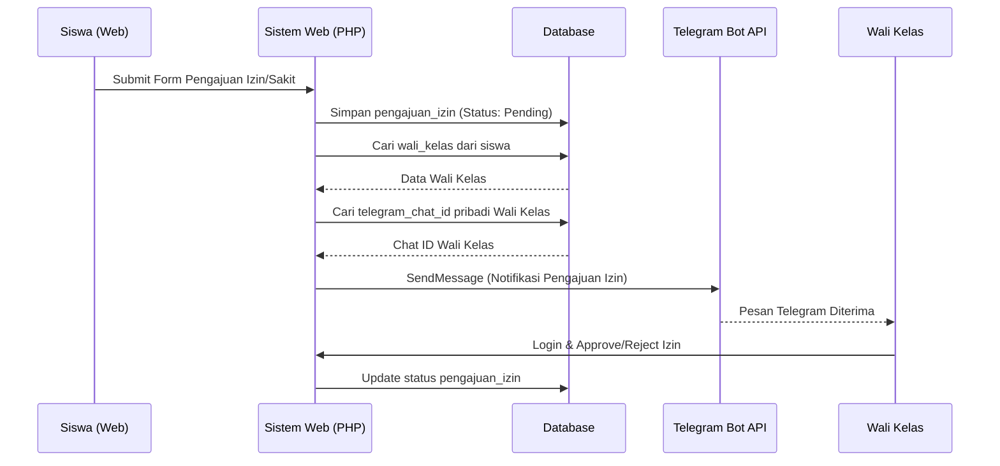
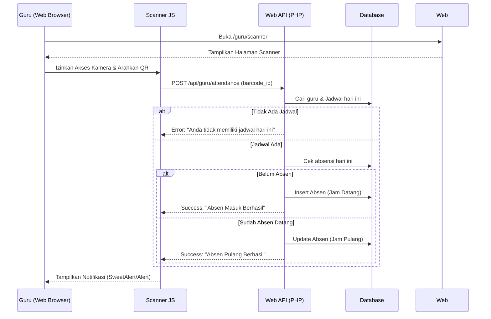

# Rencana Revisi Sistem Absensi SMK Berbasis RFID, Barcode/QR, Web, Telegram Bot, dan AI Chatbot

Berikut adalah hasil audit, bagian yang direvisi, desain database terbaru, diagram relasi, serta alur (flow) sistem sesuai dengan kebutuhan terbaru yang Anda sampaikan.

## 1. Audit Struktur Project & Bagian yang Perlu Direvisi

Berdasarkan struktur proyek saat ini (`/web`, `/iot`, `/database`), berikut adalah bagian yang perlu direvisi:

1. **Jadwal Guru (Sangat Penting):** 
   - **Saat ini:** Sistem menggunakan satu tabel `jadwal_absensi` secara global.
   - **Revisi:** Akan dibuat tabel khusus `jadwal_guru` yang mengatur jadwal setiap guru per hari secara spesifik (jam datang, batas terlambat, jam pulang, aktif/nonaktif).
2. **Sistem Barcode/QR Guru:**
   - **Saat ini:** Diarahkan menggunakan ESP32 (ada folder `iot/esp32_qr` dan tipe `BARCODE_GURU` di database).
   - **Revisi:** ESP32 untuk QR Guru akan dihapus. Absensi guru akan menggunakan antarmuka web (kamera browser dengan JavaScript) di `/guru/scanner`.
3. **Notifikasi Telegram:**
   - **Saat ini:** Belum ada integrasi Telegram.
   - **Revisi:** Penambahan field `telegram_chat_id` pada tabel `kelas` (untuk notifikasi absensi siswa per kelas) dan tabel `users` (untuk wali kelas saat menerima pengajuan izin).
4. **Landing Page:**
   - **Saat ini:** Belum ada landing page publik, langsung masuk ke logika dashboard.
   - **Revisi:** Penambahan halaman utama (`/`) sebagai Landing Page sekolah.
5. **Logika Absensi Siswa (RFID):**
   - ESP32 tidak perlu dikonfigurasi per kelas. Logika API di backend akan mengambil data RFID, melacak siswa, kelas, wali kelas, dan `telegram_chat_id` kelas untuk pengiriman pesan.

---

## 2. Desain Database Terbaru

Berikut adalah ringkasan perubahan skema database utama untuk mendukung fitur terbaru:

### [NEW] `jadwal_guru`
Menyimpan jadwal absensi spesifik per guru per hari.
- `id` (INT, PK)
- `guru_id` (INT, FK ke tabel `guru`)
- `hari` (ENUM: 'Senin', 'Selasa', 'Rabu', 'Kamis', 'Jumat', 'Sabtu', 'Minggu')
- `jam_datang` (TIME)
- `batas_terlambat` (TIME)
- `jam_pulang` (TIME)
- `is_active` (BOOLEAN)

### [MODIFY] `jadwal_siswa` (Sebelumnya `jadwal_absensi`)
Hanya digunakan untuk jadwal global siswa/sekolah.
- `id` (INT, PK)
- `hari` (ENUM)
- `jam_mulai_absensi` (TIME)
- `jam_datang` (TIME)
- `batas_terlambat` (TIME)
- `jam_pulang` (TIME)
- `status_aktif` (BOOLEAN)

### [MODIFY] `kelas`
Penambahan Chat ID Telegram untuk notifikasi grup kelas.
- `id` (INT, PK)
- `nama_kelas` (VARCHAR)
- `wali_kelas_id` (INT, FK ke `users`)
- `telegram_chat_id` (VARCHAR, NULL) - *[NEW]*

### [MODIFY] `users`
Penambahan Chat ID Telegram pribadi (untuk notifikasi pengajuan izin ke Wali Kelas).
- `id` (INT, PK)
- `username` (VARCHAR)
- `password` (VARCHAR)
- `name` (VARCHAR)
- `role` (ENUM)
- `telegram_chat_id` (VARCHAR, NULL) - *[NEW]*

### [MODIFY] `iot_devices`
Hanya untuk RFID (menghapus opsi BARCODE_GURU).
- `device_type` ENUM('RFID_SISWA')

---

## 3. Diagram Relasi (ERD)



---

## 4. Alur (Flow) Sistem

### A. Flow RFID → Database → Telegram (Absensi Siswa)



### B. Flow Izin → Wali Kelas → Telegram



### C. Flow Barcode → Browser JS → API (Absensi Guru)



### D. Flow Landing Page → Login → Dashboard

```mermaid
flowchart TD
    A[Public Visitor / User] --> B{Buka URL Root `/`}
    B -->|Tampil| C[Landing Page Sekolah]
    C -->|Klik Login| D[Halaman Login]
    D --> E{Authentication (Cek Role)}
    E -->|Admin| F[Dashboard Admin]
    E -->|Guru| G[Dashboard Guru]
    E -->|Wali Kelas| H[Dashboard Wali Kelas]
    E -->|Kepsek| I[Dashboard Kepsek]
    E -->|Siswa| J[Dashboard Siswa]
```

---

## 5. Pertanyaan / Keputusan Terbuka (Open Questions)

Sebelum kita mulai menulis kode dan mengubah struktur direktori:
1. **Penyimpanan Token Bot Telegram:** Apakah Anda ingin kita simpan Token Bot Telegram di dalam tabel `config` / `settings` di database agar admin bisa mengubahnya dari web, atau cukup ditaruh di file `.env` saja?
2. **Library Scanner:** Saya akan menggunakan library JavaScript populer yang stabil seperti `html5-qrcode` untuk membaca barcode/QR code langsung dari kamera browser. Apakah Anda setuju?

Silakan tinjau dan klik **Proceed** jika Anda setuju dengan seluruh rancangan dan arsitektur baru ini, atau berikan catatan revisi tambahan.
